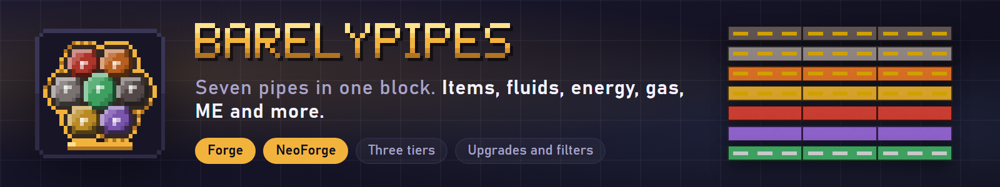
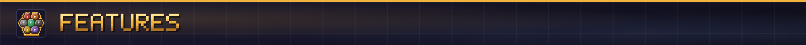
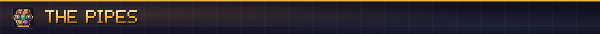
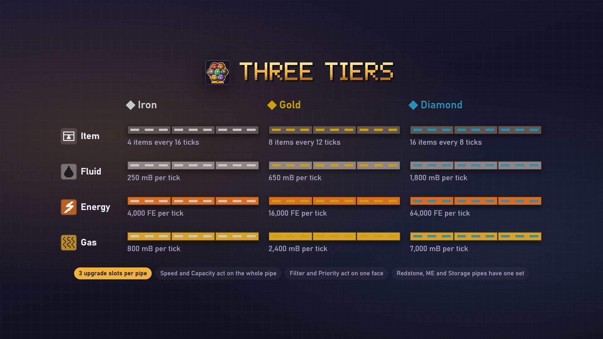
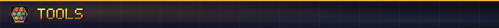
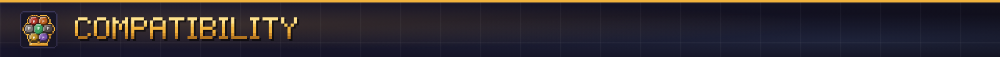
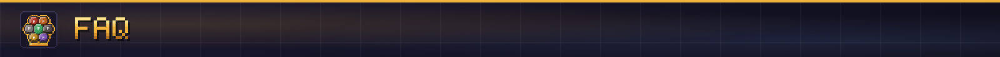

**Seven pipes in one block for Forge and NeoForge: items, fluids, energy, gas, redstone, AE2 ME and BarelyStorage.**

Barely Pipes is the pipe system of AeroFlux as a mod of its own. A pipe is two pixels thin, and up to seven different pipes share one block, the pipe bundle, so one run can carry items, fluid, power, a redstone signal and an ME network side by side. Each pipe has its own mode on every face, three tiers, upgrades, and two tools to edit whole runs. It has no machines and no ores: it moves what other blocks already hold.

Docs and recipes: [itmecasey.com/wiki/barelypipes](https://itmecasey.com/wiki/barelypipes/)

- **One block, seven pipes:** a bundle holds at most one pipe of each kind. Pipes join the same kind next to them and attach to any block that has what they carry.
- **Per-face modes:** every pipe has Open, Import, Export, Off or Blocked on each of the six faces of its bundle.
- **Distribution modes:** round robin, first to last, last to first or random decide who is served first.
- **Three tiers:** iron, gold and diamond for item, fluid, energy and gas pipes. A higher-tier pipe used on a bundle upgrades the pipe in place and keeps its settings.
- **Upgrades:** Speed and Capacity raise a whole pipe (three slots). Filter and Priority work on one face: Filter whitelists or blacklists items and fluids, Priority ranks destinations from -5 to +5.
- **A pipe screen:** right-click a pipe where it meets a face for a screen made of glyphs with modes, distribution, throughput, upgrade slots, filter and priority.
- **Two tools:** the Pipe Wrench cycles a face's mode (sneak: the distribution mode), and the Conduit Tool edits, removes, removes a whole run, copies, pastes (also along a run) and inspects.
- **Claim friendly:** the Conduit Tool asks the standard permission events before it changes or removes pipes, so claim mods can veto it.

- **Item Pipe:** 4, 8 or 16 items per operation, every 16, 12 or 8 ticks.
- **Fluid Pipe:** 250, 650 or 1,800 mB per tick, any fluid.
- **Energy Pipe:** 4,000, 16,000 or 64,000 FE per tick between any blocks that take Forge Energy.
- **Gas Pipe:** 800, 2,400 or 7,000 mB per tick of Mekanism gases and chemicals. It needs Mekanism, which exists for Minecraft 1.20.1 (Forge and NeoForge) and 1.21.1 (NeoForge only); on the other seven builds the item exists but is inert, because Mekanism has no build for them.
- **Redstone Pipe:** carries one redstone signal along the run.
- **ME Pipe and Dense ME Pipe:** join Applied Energistics 2 grids with 8 channels (32 for Dense). The recipes only load with AE2.
- **Storage Pipe:** joins BarelyStorage networks and ordinary inventories at a fixed speed. The recipe only exists on Minecraft 26.1.2, 26.2 and 26.3, where BarelyStorage exists; on 1.20.1 and 1.21.1 the pipe can only join inventories.

- **Pipe Wrench:** use it on a pipe to cycle that face through Open, Import, Export, Off and Blocked. Sneak and use it to cycle the distribution mode instead. It picks the pipe nearest your crosshair, so you do not have to hit a two-pixel pipe exactly.
- **Conduit Tool:** sneak and use it in the air to change mode. Edit (like the wrench), Remove (sneak: the whole bundle), Remove run (two clicks, a straight line of up to 64 blocks), Copy, Paste (it also adds missing pipes from your inventory, and sneak-use marks the two ends of a run to paste along) and Inspect (describes the network in chat and outlines it).

- **BarelyStorage** (our storage mod, Minecraft 26.1.2, 26.2 and 26.3): the Storage Pipe moves items between its racks, nodes and cables, ordinary inventories, and other networks.
- **Applied Energistics 2:** ME pipes carry a real ME grid. Recipes load only when AE2 is installed.
- **Mekanism** (Minecraft 1.20.1 on Forge and NeoForge, 1.21.1 on NeoForge): the Gas Pipe joins Mekanism tanks and machines and moves their gases. Mekanism has no build for 1.21.1 Forge, 26.1.2, 26.2 or 26.3, so there the Gas Pipe does nothing.
- **Forge Energy and the standard fluid and item handlers:** work with any mod that speaks them.
- Item viewers (BEI, REI, JEI, EMI) and Jade have no plugin yet; Show Me What This Is shows the exact pipe, tier and details under the crosshair on all ten builds. This is on the plan, not done.

Install: put the jar for your Minecraft version in `mods` on the server and on every client. Each file is built for one loader and one Minecraft version, so take the Forge jar or the NeoForge jar to match your loader.

The pictures on this page are illustrations drawn for the listing, not game screenshots.

**Tested:** the shared pipe logic passes 126 unit tests, and every one of the ten builds passes a headless server self test (228 checks on 26.x including the Storage Pipe moving items in both directions against a real BarelyStorage rack; 222 on 1.20.1 and 1.21.1 without Mekanism, 229 with it). Each build ran a scripted client tour in a real game on 2026-11-06 with the screenshots read, and the 2026.11.2 changes (outline, plug arrows, centered glyphs, the Show Me What This Is lines) were looked at in client frames on NeoForge 26.1.2, 26.2, 26.3, Forge 26.1.2 and NeoForge 1.21.1: the seven pipes, the three tiers, plates and plugs on a chest, and the pipe screen render correctly. The Gas Pipe was checked on the three builds that have Mekanism (Forge 1.20.1, NeoForge 1.20.1, NeoForge 1.21.1): the self test moves 40,000 mB between two real Mekanism chemical tanks through gas pipes, loses nothing and never exceeds 800 mB per tick for an iron pipe, and those builds also pass without Mekanism installed. Not checked: multiplayer, long play sessions, AE2 grids with real devices, Mekanism machines other than the chemical tank, and tank contents in the client screenshots (the tank models in them show nothing either way).

**Which jar do I use?** The one named for your loader and Minecraft version: `barelypipes-<loader>-mc<mc>-<release>.jar`, where the loader is `forge` or `neoforge`. There is one jar per loader for each of the five Minecraft versions.

**Does it need to be on the server?** Yes, on the server and on every client.

**Does it need another mod?** No. BarelyStorage and Applied Energistics 2 are optional and only unlock their own pipes. Mekanism is optional too and only unlocks the Gas Pipe, on 1.20.1 (Forge and NeoForge) and 1.21.1 (NeoForge).

**Why can I not craft the Storage Pipe on 1.21.1?** BarelyStorage has no build for 1.20.1 or 1.21.1, so the pipe has no recipe there and can only join inventories.

**Can I change the numbers?** Not yet. The tier rates are built in. The config file has two switches: extra logging and the Conduit Tool claim check.

**Fabric?** Not at this time.

**Can I use it in my modpack?** Yes. It is MIT licensed.

Made by ItMeCasey Studios. Source and issues on [GitHub](https://github.com/ItMeCasey/BarelyPipes).
